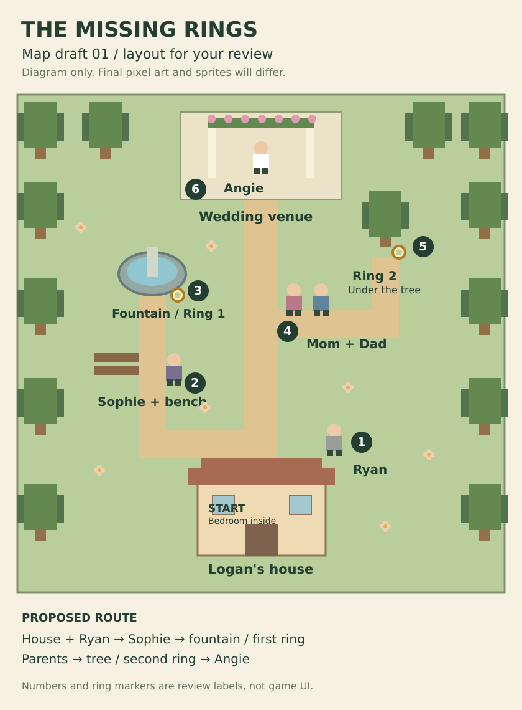

# Map draft 01 — layout approved with garden gate

This is a layout diagram, not final pixel art or approved character sprites. The provisional heading is not an approved game title. Numbers and ring markers are planning annotations, not a decision to reveal ring positions in the game.

## Approved arrangement

- Logan's house at the south, with a separate tiny bedroom opening and a garden-facing exit to the main path. House art and doorway placement are schematic.
- Ryan close to the house.
- Sophie beside a bench on the west branch.
- Fountain just north of Sophie, with the first ring discoverable along its edge.
- Parents on the east branch nearer the venue.
- Second ring beneath the nearby tree.
- Angie beneath the flower arch at the north end.
- Hedges/fencing enclose the ceremony area, with a single garden gate on the central path. Logan cannot go around it or approach Angie early.
- Both ring locations and the clue NPCs stay outside the gate.

The route is short and contained. Exact collision tiles, map dimensions, camera framing, and decoration remain implementation details within the approved arrangement. The whole-map diagram is an overview; it does not require showing the entire world on a phone at once.

## Suggested clue wording — not yet approved

After Sophie's existing lead-in: "I think I saw you at the fountain. Maybe check around the edge?"

After the parents' approved reactions, Father could say: "You were sitting under that tree earlier. Did you leave anything there?"

Updated November 8: Ryan's earlier three-line exchange is superseded by a sympathetic response and a direct lead to Sophie by the bench, since she was the last person Logan was with the previous night. See GAME_DESIGN.md and src/content.js for current wording. Logan notices the missing rings only when attempting to leave his bedroom for the ceremony.

## Review checkpoint

Lucas approved the arrangement and requested that Angie cannot be approached until both rings are gathered. He then authorized the proposed garden gate addition. The diagram now includes that gate. Final environment art and character sprites remain subject to separate review.

## Gate behavior

- Zero rings or either single ring: gate closed; physically blocks entry.
- Early interaction: "I need to find both rings first!"
- Both distinct rings: opens automatically, allowing the approach to Angie.
- Gate state is derived from saved ring progress on reload.
- Repeatedly collecting one ring must not unlock it.
- Angie's interaction checks both rings independently as a safeguard.

The playable review build now implements this gate and collision behavior. Lucas reviewed the first version on his phone and reported that layout and movement seem good; art remains provisional.
