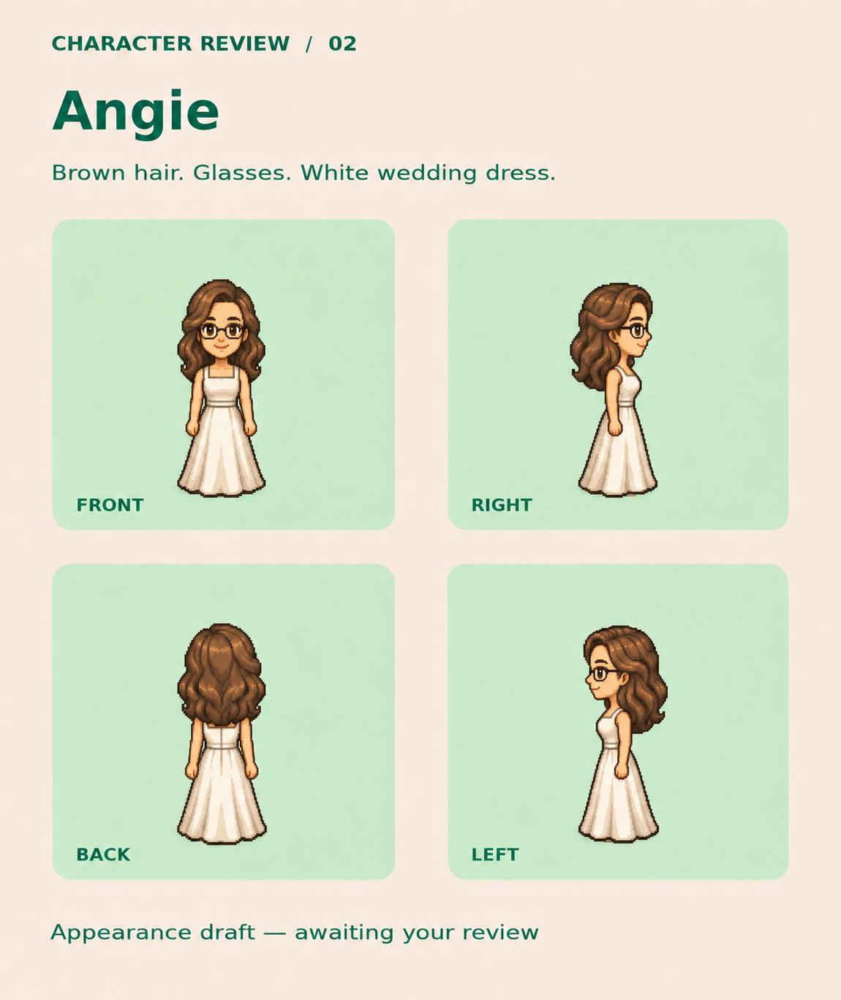

# Angie — approved appearance 01

Lucas approved this appearance on November 7, 2026 after reviewing her slimmer arms and photo-guided face shape.

## Appearance to preserve

- Youthful adult face guided by the supplied couple photo: elongated oval face, softly tapering jaw, and gently rounded chin.
- Shoulder-length softly wavy brown hair, with the reviewed volume, part, and color.
- Dark rectangular glasses with rounded corners.
- Slim arms with naturally tapered wrists and proportionate hands.
- White sleeveless wedding dress with broad straps, square neckline, fitted waist, and softly flared skirt.
- Consistent front, right, back, and left views in the same cozy pixel-art direction as Logan.

This is the approved **appearance reference**, not an animation-ready sprite sheet. Prepare and review sprites against this board before game integration.

## Provenance and credits

Created and refined with the built-in image editor using Logan's approved board as the style/format reference and the supplied couple photo as Angie's likeness reference. The final refinement slimmed the arms and adjusted the face toward the photograph. Personal reference photos are not included in the repository.

The board carries forward the LPC-derived visual reference used for Logan. Retain the composition's CC-BY-SA 4.0 attribution chain: see [Logan's approved reference](../logan-approved-01/README.md) and [the pinned source/credit recipe](../logan-draft-01/recipe.json). Angie's dress, hair, and glasses are generated interpretations, not newly sourced LPC layers. Preserve the relevant source credits and modification notices when shipping derivative art.

## File verification

- PNG size: 1653224 bytes.
- Git blob SHA-1: `356321326af8e4d2bf98da5a93f47d8b333c775e`.
- Saved without resizing or recompressing the approved image.
