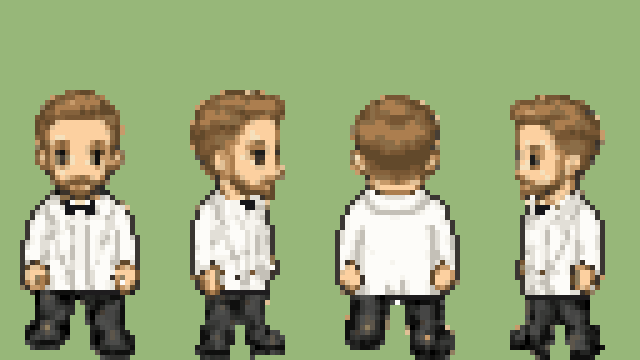
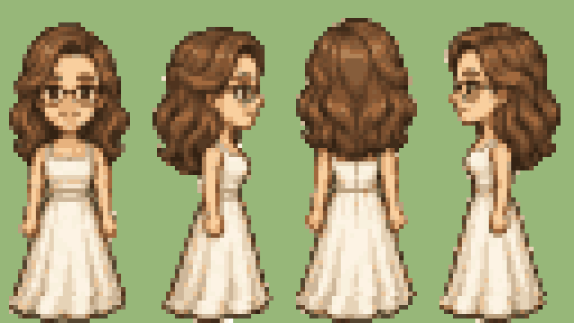
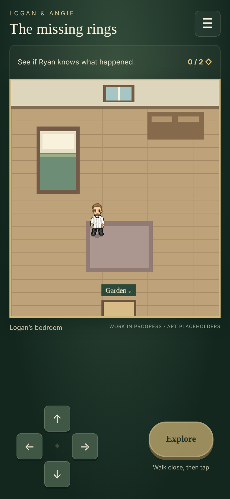
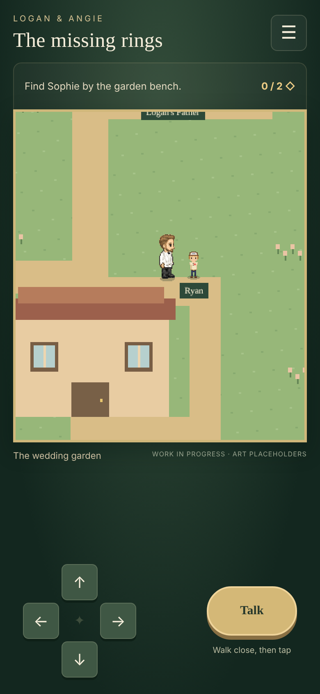
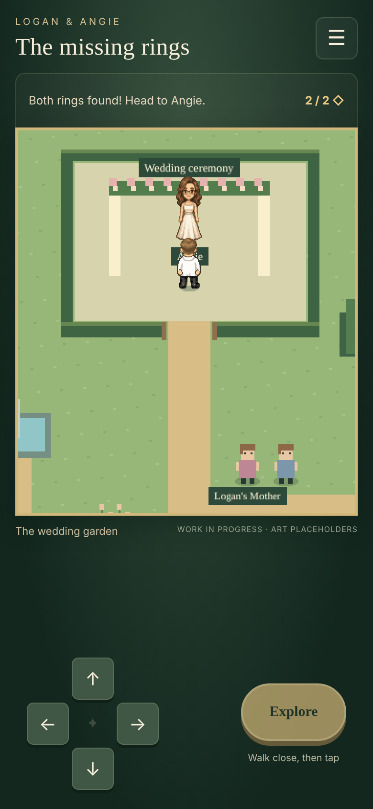

# Board-style sprites 01 — Logan and Angie

**Not used for map sprites.** After seeing these in the game, Lucas chose simple map sprites with the detailed models as dialogue portraits instead (see [simple-styles-01](../simple-styles-01/README.md)). These extractions may still help with the portraits.

On November 8, 2026 Lucas chose the style of the approved character boards for every character, with one revision to Logan: the white shirt and black bow tie, without the jacket.

| Logan | Angie |
| --- | --- |
|  |  |

## How they are made

`tools/sprites/from_board.py` turns each approved board into game-scale sprites:

1. Lift each of the four poses off its mint panel.
2. Shrink by 4.5 (the same factor for every character) and snap edges and colours to a 24-colour palette per character. Logan is about 54 px tall and Angie about 67 px tall, matching the boards' proportions.
3. Logan only: the jacket becomes a white shirt (its shading stretched into soft grey folds), with a black belt at the waist and a black bow tie at the collar.
4. Walking: Lucas chose simple step-and-bob frames. Logan lifts one foot (front and back) or strides (sides); Angie's hem sways. The body bobs up 1 px.

```sh
python3 tools/sprites/from_board.py
```

## Runtime sheets

`logan-board-sheet.png` and `angie-board-sheet.png` (moved out of `public/` since they are not used in the game): 96 × 288 px, 32 × 72 frames. Rows are down, right, up, left; columns are stand, step A, step B. Feet touch the bottom of each frame.

Enlarged sheets: [Logan](logan-sheet-x6.png), [Angie](angie-sheet-x6.png).

## Provenance and credits

Derived from the approved boards ([Logan](../logan-approved-01/README.md), [Angie](../angie-approved-01/README.md)), which carry the LPC-derived CC-BY-SA 4.0 attribution chain recorded in [the draft 01 recipe](../logan-draft-01/recipe.json). These sprites keep that licence and attribution; the changes are extraction, downscaling, palette reduction, Logan's shirt recolouring and the added walking frames. No personal photo pixels are used.

## Still to do

Ryan, Sophie, Logan's Mother and Logan's Father need art in this style before the game can switch over. Ryan's approved board is in the simpler style.

## In-game preview

Checked in a temporary local build (not committed) in Chromium at a 390 × 844 phone viewport. Logan uses the new sheet with walking animation; Angie uses hers; Ryan still has his smaller approved 16 × 32 sprite; Sophie and the parents are still placeholders.

| Bedroom | Garden, beside Ryan | Ceremony |
| --- | --- | --- |
|  |  |  |

At the current garden zoom Logan stands about 54 px tall and Angie about 67 px, roughly twice Ryan's height. The rest of the cast needs to be redrawn at this size to match.
