# The cast — map sprites in the chosen style (in the game)

**Decision, November 8, 2026 (Lucas):** full-colour style 12 from [simple-styles-01](../simple-styles-01/README.md), "a mix of older Pokémon games and Stardew". Every character is the same size, like Pokémon. When characters talk, the conversation box shows their detailed picture.

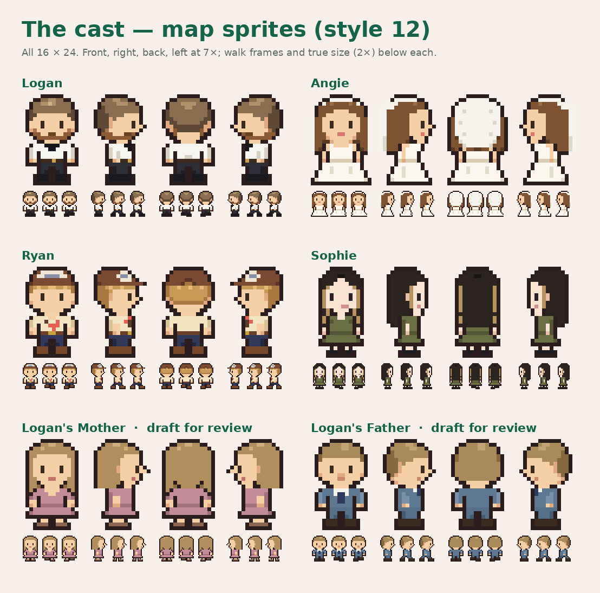

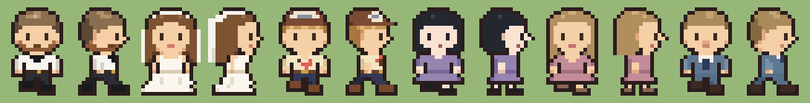

| Character | Status |
| --- | --- |
| Logan | **Approved November 8, 2026.** Short dirty-blond hair, short beard, white shirt and black bow tie, black trousers. |
| Angie | Wavy brown hair, white gown, regular eyes (no glasses), and a short veil (Lucas, November 8). Her portrait keeps her glasses (Lucas) and adds the veil. |
| Ryan | **Approved November 8, 2026.** Cap worn forward, blond hair, cream flower shirt, sunglasses, navy trousers. |
| Sophie | **Chosen November 8, 2026:** long dark hair with caramel streaks (from Lucas's reference photos, not stored here), skinnier body, small nose, olive dress. In the game; portrait is a stand-in (enlarged sprite) until a detailed model is made. |
| Logan's Mother | First draft: dirty-blond hair, dusty-rose dress (details were deferred). Needs review. |
| Logan's Father | First draft: dirty-blond hair, slate-blue suit and tie (details were deferred). Needs review. |

## In the game

- Sheets: `public/sprites/<id>.png`, 48 × 96 px: 16 × 24 frames; rows down, right, up, left; columns stand, step A, step B. Feet touch the bottom row (origin 0.5, 1).
- Logan walks with a four-frame cycle and faces the way he moves. Characters turn to face Logan when he talks to them. Characters are drawn in front of anyone standing further up the screen.
- The camera zooms to 1.5× so the 16 × 24 sprites read well on a phone (about 36 CSS px tall). The map layout and collisions are unchanged.
- Dialogue portraits: `public/portraits/<id>.png` (96 × 96) beside the speaker's name. Logan's and Angie's come from their approved models (Logan with the white shirt); Ryan's from his approved board. Sophie and the parents show an enlarged sprite until their detailed models are made.

Chromium, 390 × 844 phone viewport:

| Bedroom | Garden | Ryan talking | Logan talking | Ceremony | Angie talking |
| --- | --- | --- | --- | --- | --- |
| 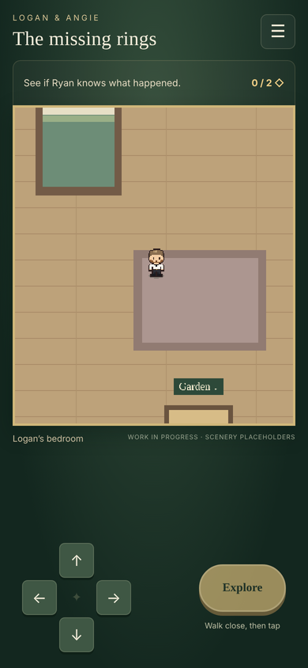 | 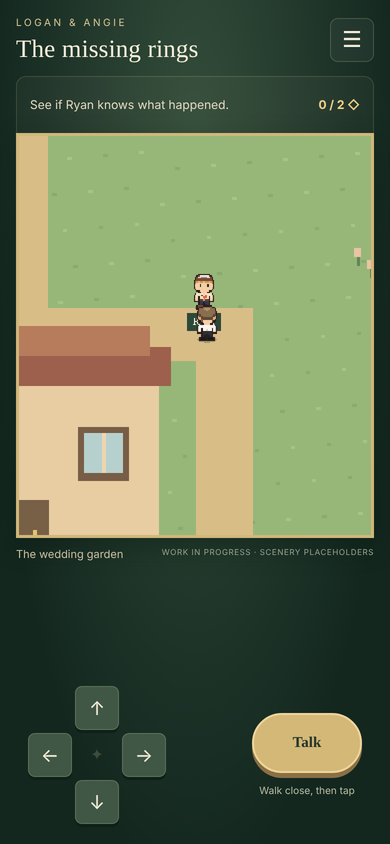 | 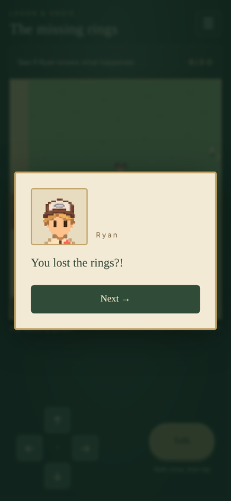 | 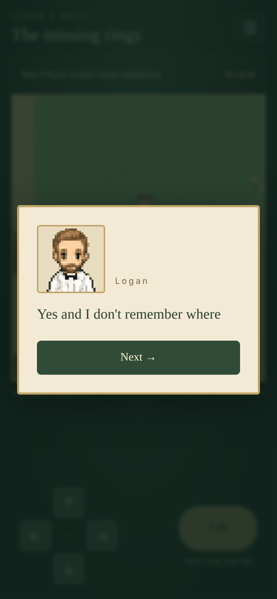 | 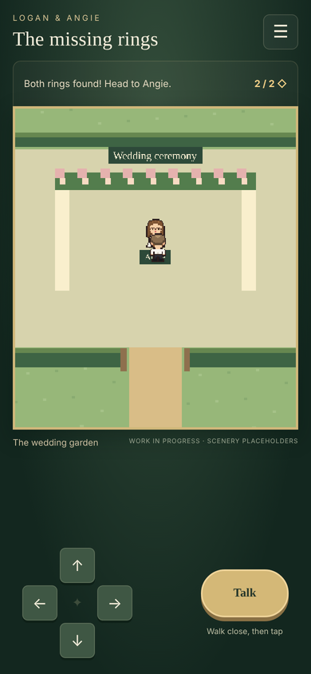 | 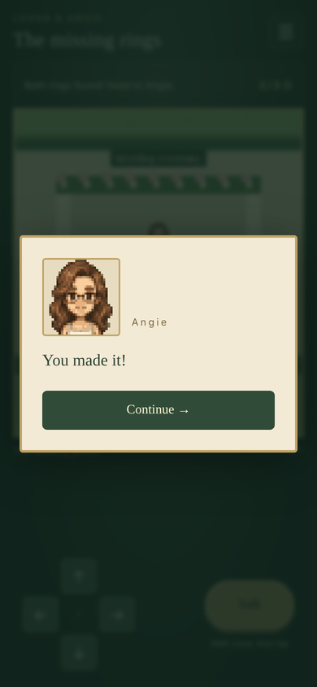 |

## Rebuild

```sh
python3 tools/sprites/cast12.py     # map sprites + review images
python3 tools/sprites/portraits.py  # dialogue portraits
```

All map-sprite pixels are original and hand-placed. Portrait credits are in `public/LICENSES.txt`.

## Sophie options

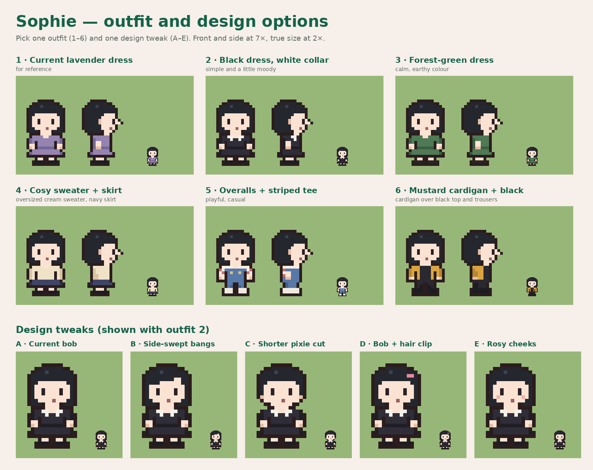

Rebuild: `python3 tools/sprites/sophie_options.py`.

## Angie detail options and skinnier Sophie

Lucas liked Angie without glasses but wanted a little more detail, and asked for a skinnier Sophie.

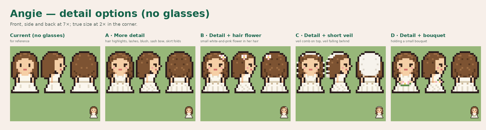

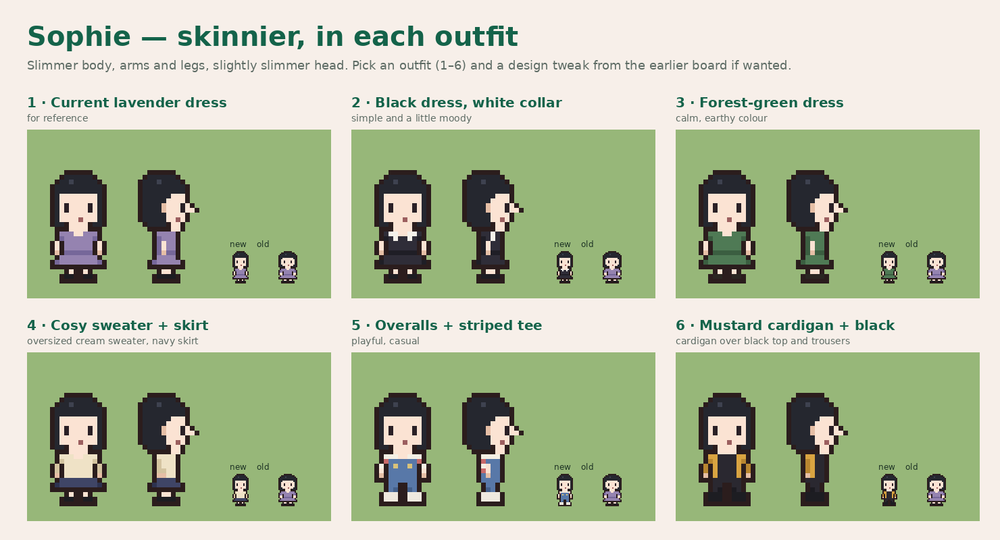

Rebuild: `python3 tools/sprites/angie_sophie_options.py`.

## Angie's veil and Sophie's photo-guided options (November 8)

Angie keeps her no-glasses map sprite and gains a short veil (band on top, falling behind her hair). Her portrait keeps her glasses, at Lucas's request, and also gets the veil.

Sophie: Lucas asked for a smaller nose and attached reference photos, which are not stored in the repository. They show long dark hair with caramel-blonde streaks, dark-framed glasses, an olive-green top and a small nose.

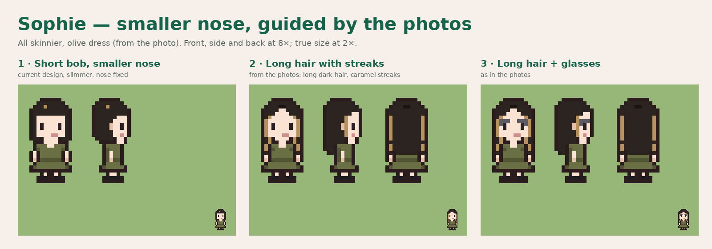

Rebuild: `python3 tools/sprites/sophie_photo.py`.
