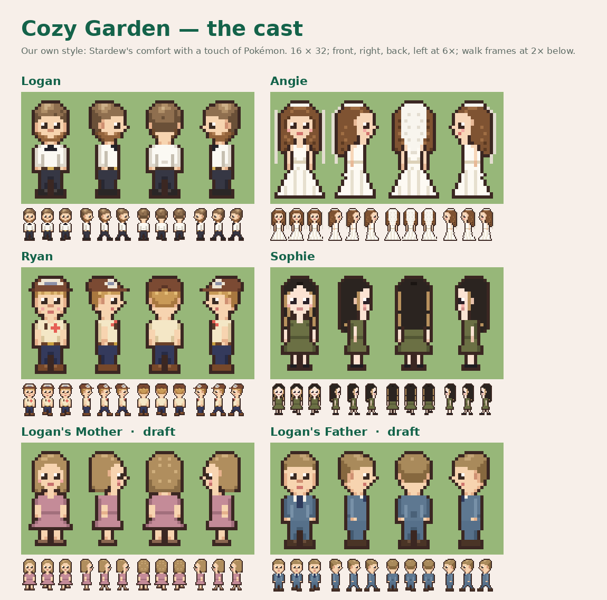
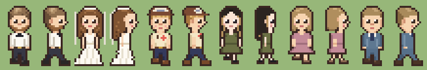

# Cozy Garden — the game's own character style

**In the game since November 8, 2026.** Lucas gave full creative freedom to make a Stardew-like style after the 16 × 24 sprites looked too pixelated in the playtest.

## The style

- 16 × 32 characters, Stardew's standard size, shown at a whole-number zoom so every pixel is crisp.
- Soft warm-brown outlines (never black), gentle shading lit from the upper left.
- Round, friendly faces: a highlight in each eye, rosy cheeks, small mouths.
- Hair with strands and highlights; natural bodies with hands at the sides.
- A touch of Pokémon: clean colours and a slightly large head.
- Four-direction walking: stand, step A, step B (Angie's gown sways).

Approved features are kept: Logan's white shirt and bow tie; Angie without glasses and with her veil (her portrait keeps the glasses); Ryan's cap, blond hair, cream flower shirt and navy trousers; Sophie's long dark hair with caramel streaks, skinny build and olive dress. Logan's Mother and Father are still drafts.

## Files

- `public/sprites/<id>.png`: 48 × 128, 16 × 32 frames; rows down, right, up, left; columns stand, step A, step B.
- Built by `python3 tools/sprites/cozy.py`. Every pixel is original and hand-placed. Leg and shoe templates come from `tools/sprites/characters.py`.
- Portraits: Logan, Angie and Ryan from their detailed models; Sophie and the parents use an enlarged Cozy Garden head-and-shoulders until detailed models exist (`python3 tools/sprites/portraits.py`).
