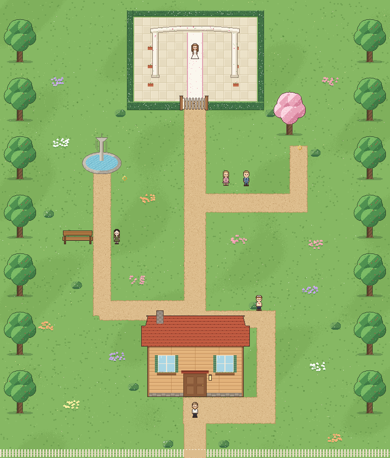
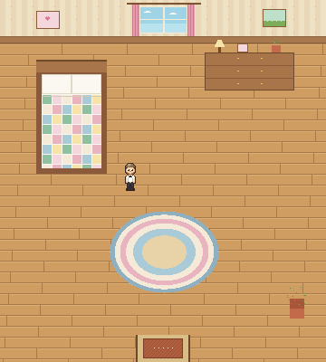
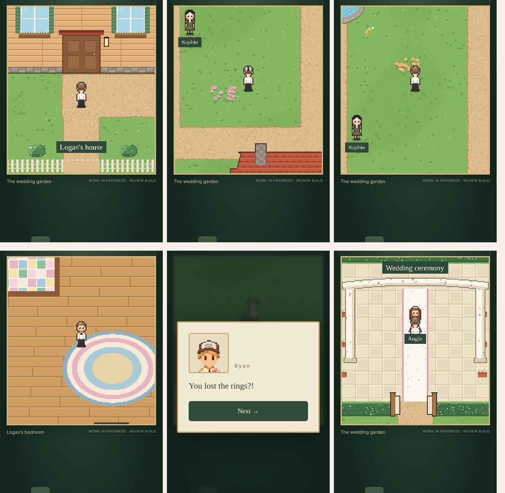

# Cozy Garden scenery

**In the game since November 8, 2026.** Lucas gave full creative freedom over the environment and the rest of the map: "make it cozy and comfortable".

| Bedroom | In the game |
| --- | --- |
|  |  |

## What changed

Only the look. The approved layout is untouched: every path, hedge, gate, obstacle and collision box, both ring spots and every character position match `src/world.js` and the old code-drawn scenery, so the route and the clues play exactly as before.

- **Garden:** soft grass with gentle patches, tufts and wildflowers; dirt paths with wobbly grassy edges and pebbles; flower beds; round bushes; a white picket fence along the bottom with a gap where the path leaves.
- **Logan's house:** a plank cottage with a terracotta shingle roof, a stone chimney, shuttered windows with flower boxes, a panelled door under a little canopy, a lantern and a stone foundation.
- **Fountain:** stone basin with rippling water and a spray (two-frame animation).
- **Trees:** round apple trees along both sides; a pink blossom tree marks the second ring, matching Logan's Father's clue about the tree.
- **Sophie's bench:** wooden slats.
- **Ceremony:** cream stone tiles, a white aisle runner with rose-pink edges and scattered petals, flower pots along the aisle, a white rose-and-vine arch, leafy hedges with little blossoms, and a picket gate that swings open once both rings are found.
- **Extras:** butterflies drifting over the garden; the rings twinkle.
- **Bedroom:** honey floorboards, flowered wallpaper with a wood trim, a window with pink curtains and clouds, framed pictures, a bed with a patchwork quilt, a dresser with a lamp, photo and plant, a woven oval rug, a potted plant and a doormat.

Tall objects (house, trees, fountain, bench, arch, gate) are separate images, depth-sorted by their base, so characters walk in front of and behind them.

## Files and rebuild

`public/env/*.png` are built by `python3 tools/env/build_env.py` (deterministic; all original pixel art). `python3 tools/env/preview.py` composes the review images here using the same positions as `src/main.js`.
