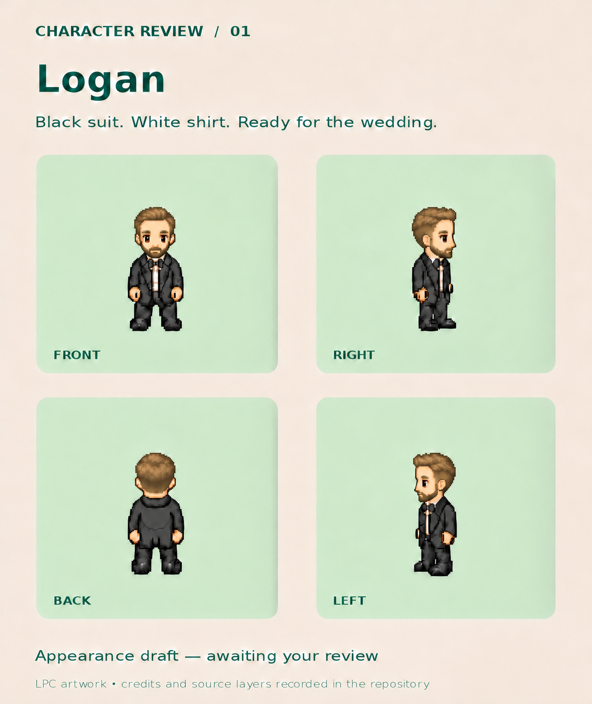

# Logan — approved appearance 01

Lucas approved this appearance on November 7, 2026 after reviewing the face, haircut, head proportions, and softer hair texture.

## Appearance to preserve

- Youthful, lean face modeled after the supplied reference photos, with a defined jaw and gently rounded nose.
- Smaller head relative to the body than the earlier drafts.
- Muted dirty-blonde hair and matching short beard.
- Short tapered sides and back, with a compact, slightly lifted, brushed-back top.
- Soft, matte hair shading; avoid strongly outlined parallel comb grooves.
- Black suit, white shirt, black bow tie, and black shoes.

This board is the approved **appearance reference**, not a rigged model or animation-ready sprite sheet. The draft 01 walking sheet still shows the older appearance and must be revised and checked against this board before integration. The playable game has not been changed by this approval.

## Provenance and credits

The board was iteratively revised with the built-in image editor from the original LPC-based draft, using personal photos as visual references. Personal reference photos are not included in the repository.

Underlying source layers, pinned sources, artists, and license choices remain recorded in [the original recipe](../logan-draft-01/recipe.json). This derivative review artwork retains the composition's [CC-BY-SA 4.0 license](https://creativecommons.org/licenses/by-sa/4.0/). Modifications include hair and beard recoloring, leaner body and face, youthful styling, photo-guided haircut and facial proportions, nose rounding, smaller head, and softer hair shading. The complete attribution must accompany any shipped derivative sprites.
