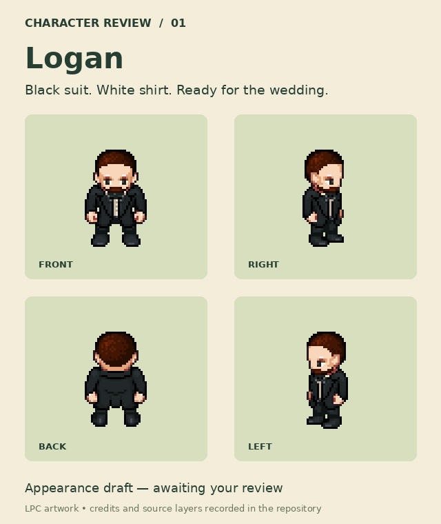
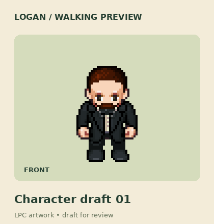

# Logan — character draft 01

**Awaiting Lucas's individual character review.** This is a reusable sprite candidate, not an approved replacement in the live game. The map, movement, collision, dialogue, and saved progress have not been changed.





## Design

- Short brown hair and a trimmed beard, using the supplied photos as appearance references.
- Black formal jacket and trousers, white shirt, black bow tie and shoes.
- Shaded pixel art with four-direction walking, assembled from reusable LPC layers.
- The precise haircut, beard, and proportions are open for review. The bow tie is a proposed accessory, not a previously approved requirement.
- Review the character before committing the other NPCs to this style. Environment art is a separate step.

## Rebuild and attribution

`recipe.json` records the pinned source repository/commit, layer paths, artists, original licenses, original source links, and output frame layout. `compose.py` assembles only the walk rows. Run it with a local checkout of that pinned revision; it requires Pillow and the DejaVu Sans fonts used for the review cards.

```sh
python compose.py /path/to/Universal-LPC-Spritesheet-Character-Generator
```

The sprite composition and art previews are distributed under [CC-BY-SA 4.0](https://creativecommons.org/licenses/by-sa/4.0/). Underlying layers are used under their CC-BY-SA 3.0 option or OGA-BY 3.0, as recorded per layer in the recipe. Changes: layered composition, walk-frame extraction, and nearest-neighbor preview enlargement. No image pixels from personal photos are used.

Before this sprite is shipped in the game, expose its artist credits, source links, license, and modification notice through the game's credits interface. This draft does not change the license of the game code. The included credits text preserves upstream artist identifiers and any upstream spelling quirks.
