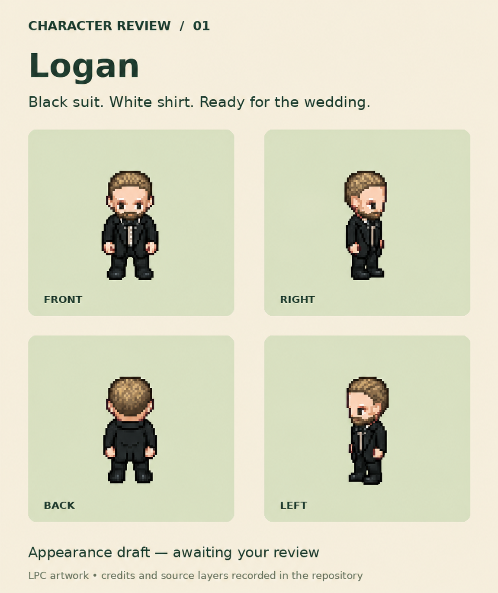

# Logan — superseded appearance draft 02

Archived to preserve earlier project work. This draft explored dirty-blond hair/beard and a leaner build. The later face refinements and final approval are recorded in [approved appearance 01](../logan-approved-01/README.md), which is the current reference.

This is an appearance board, not an animation sheet. Retain the LPC attribution chain, source artists, modification notices, and CC-BY-SA 4.0 license documented in [draft 01](../logan-draft-01/README.md) and its source recipe. The board was revised using the built-in image editor. Personal reference photos are excluded.
