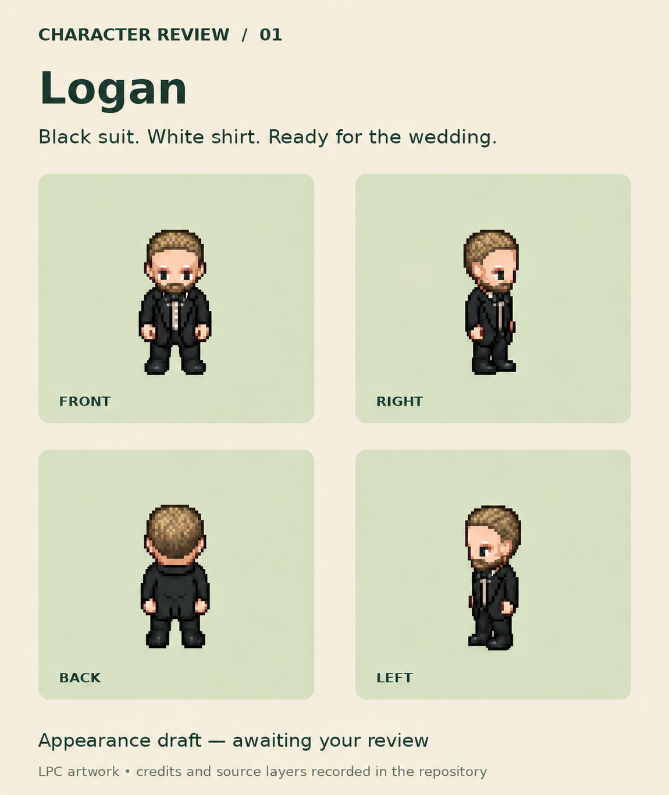

# Logan appearance revision 03 — awaiting review

Lucas requested dirty-blonde hair, a matching lighter beard, and a slightly slimmer build after draft 01. After seeing that revision, he requested a slightly slimmer face. This latest board incorporates those changes while retaining the black suit and white shirt.

This is an appearance review image, not an animation-ready sprite sheet. The draft 01 walk sheet and GIF show the earlier appearance; they must be updated to match the approved new appearance before integration. The live game has not changed.

The board was revised with the built-in image-editing tool using draft 01 as the original reference, followed by two targeted edits. First edit: natural muted dirty-blonde hair and beard; body roughly 10–12% slimmer; preserve outfit, height, poses, pixel-art aesthetic and board layout. Second edit: subtly narrow cheeks and jaw roughly 6–8%, adjusting the beard contour; preserve all other appearance details. These percentages are visual prompt targets, not measured sprite geometry.

Underlying LPC artwork attribution, original artists, source links, license choices and original composition are recorded in [draft 01's recipe](../logan-draft-01/recipe.json). This derivative review artwork retains the composition's [CC-BY-SA 4.0 license](https://creativecommons.org/licenses/by-sa/4.0/). Changes include the appearance edits described above. No personal-photo pixels are included.
