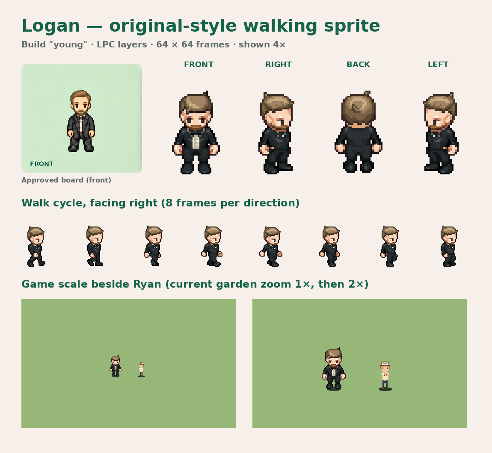
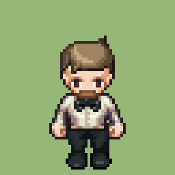
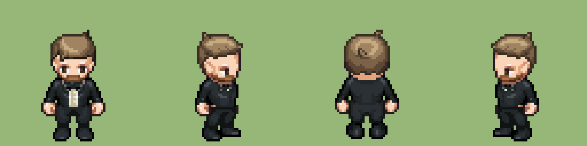
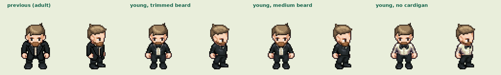

# Logan — original-style walking sprite 01

**Awaiting Lucas's review. Not yet in the game.**





This rebuilds Logan in the style of his [approved board](../logan-approved-01/README.md), which started from the LPC layers in [draft 01](../logan-draft-01/README.md). The approved board itself is a single still image with no walking frames, so the game needs a rebuilt sheet.

## Current build: "young" (revision 3)

Lucas found revision 2 too old-looking, with a "henchman" stance. Revision 3:

- Slim LPC "teen" body and the smaller male head, so he reads younger and less hulking.
- Shorter trimmed beard.
- Slim white button-up shirt and black bow tie under an open black cardigan, standing in for the jacket (the LPC formal jacket only comes in the broad build). The front-facing frames have the cardigan's front opened 4 px so the shirt shows.
- Slim black trousers and black shoes.
- Short "cowlick" hair. Colours follow reference photos Lucas supplied on November 8, 2026: light ash-brown hair, lighter on top, and a warmer ginger-brown beard. The photos are not stored in the repository and no photo pixels are used.
- Softer skin shadows, and the small head's built-in eyes recoloured from blue to brown.



Previous adult build beside the younger variants:



## Sheet

- `logan-walk.png`: 576 × 256 px, 64 × 64 frames, 9 columns. Rows are up, left, down, right. Column 0 is standing; columns 1–8 are the walk cycle.
- The figure is about 44 px tall, larger than the 16 × 32 sprites. Using this style means the other characters need the same style and size, and the garden scale may need adjusting.

## Rebuild

Needs a checkout of the LPC generator at the commit pinned in `recipe.json` (Pillow required):

```sh
python3 tools/sprites/lpc_logan.py /path/to/Universal-LPC-Spritesheet-Character-Generator
```

## Licence and credits

The composition is distributed under [CC-BY-SA 4.0](https://creativecommons.org/licenses/by-sa/4.0/). `recipe.json` lists every layer with its artists, licence and source links. Layers are used under CC0, OGA-BY 3.0, CC-BY or CC-BY-SA 3.0 as listed per layer. Changes: layer composition, an opened cardigan front, hair, beard, eye and skin-shadow recolouring, nearest-neighbour preview enlargement. These credits must appear in the game's credits before this sprite ships. No personal photo pixels are used.
