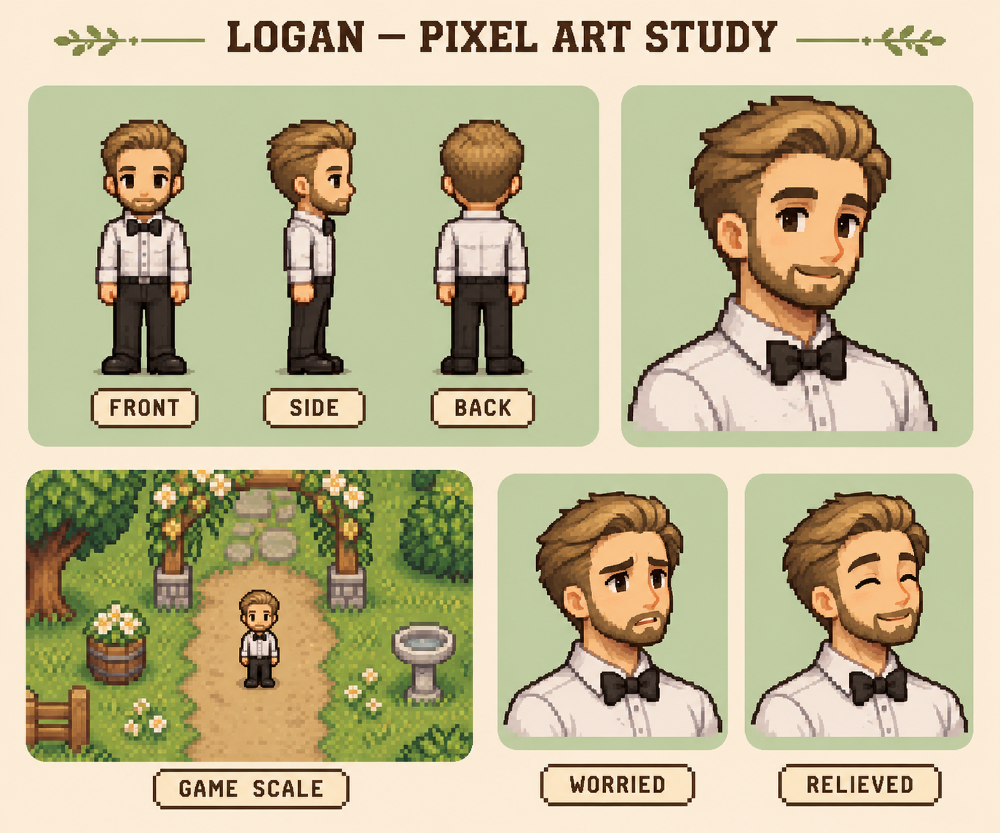
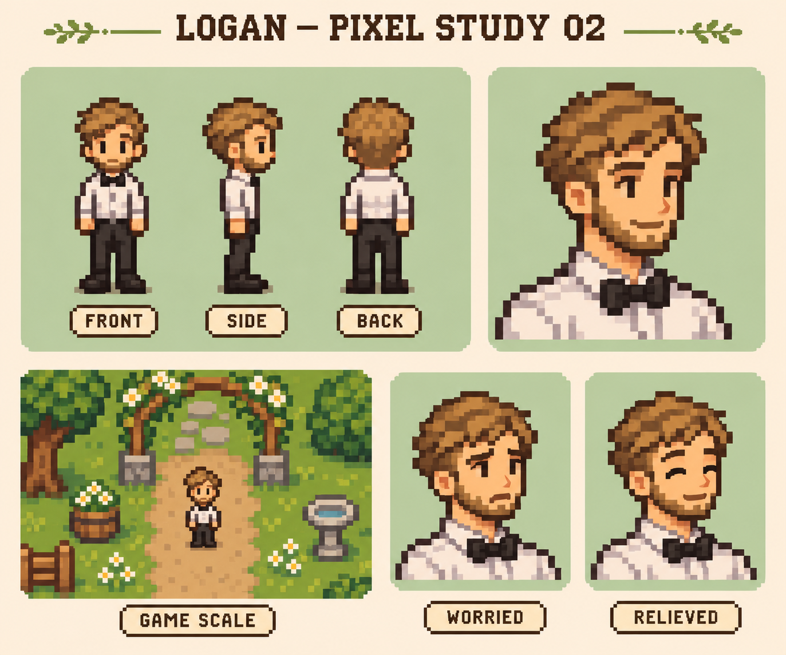
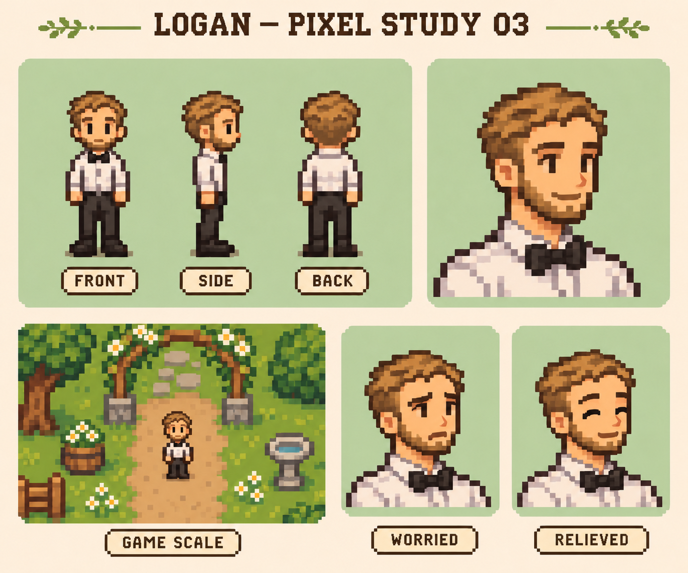
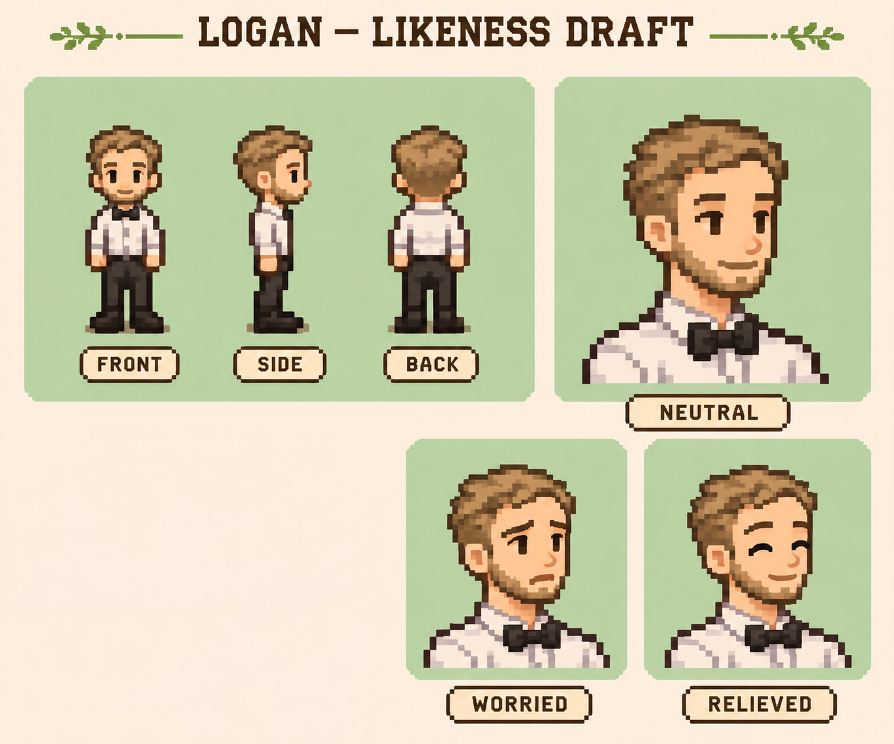

# Logan pixel-art studies — November 8, 2026

Original generated appearance studies, kept separately from runtime assets. These boards are not measured sprite sheets, animation frames, or verified game-scale screenshots. Their garden insets are illustrative concepts and do not change the approved map.

## Study 01 — preserve this style

Lucas said this style is good and requested keeping it saved. Preserve it as a reference, rather than overwriting it with later revisions. He requested a less formal hairstyle and a further move toward Stardew Valley's pixel-art language. This is not approval of a finished runtime sprite.

## Study 02 — preferred style, hair revision requested

Revision: shorter, more relaxed tousled hair and a stronger side/forward sweep; chunkier pixel shapes, simpler shading and facial marks in both the walking-character views and dialogue portraits. Preserve the youthful slim face, dirty-blond hair and short matching beard, light skin, white dress shirt, black bow tie, black trousers and shoes. Neutral, worried and relieved expressions explore the sprite/portrait distinction.

Stardew Valley is a style reference only. These are original Logan studies; no Stardew character or asset was copied or incorporated. Both boards were created with image generation and use the prior Logan appearance study as identity guidance. No personal reference photos are included.

Lucas responded, "That's much better but let's shorten his hair." Preserve this pixel treatment; study 03 addresses the requested haircut.

## Study 03 — shorter hair, superseded by approved study 04

Shortened the top, fringe, sides and back while retaining the casual shape and study 02's identity, clothes, palette and pixel treatment. This new revision has not yet received Lucas's visual approval. All three boards were created with image generation; none replaces the live game's assets.

## Study 04 — approved likeness revision

Lucas approved this exact board on November 8, 2026: "That's perfect! Let's save that to the repo and work on Angie". This is the current approved Logan appearance in the new chunky pixel style; preserve studies 01–03 as history.

Preserve the youthful lean face with softer jaw, gently rounded nose, compact casual short dirty-blond hair with muted sandy highlights, lighter short matching beard, smaller understated eyes and softer eyebrows. Keep the slim build, white shirt, black bow tie, black trousers and shoes. Front, side and back views and neutral, worried and relieved portraits show one consistent identity.

Created with built-in image generation using study 03 as the edit target and the prior approved Logan board as likeness guidance. No personal reference photos were uploaded to GitHub. Retain the prior LPC-derived attribution chain documented in [approved appearance 01](../logan-approved-01/README.md) and the pinned source recipe when preparing derivative production assets.

This approval covers the appearance concept. The board is not an aligned animation sheet or finished set of portrait crops, and it has not replaced the current Cozy Garden runtime assets.

## Next work

Carry study 04's approved style and likeness into fixed-grid runtime sprites and separate portrait crops, then check at phone size. Angie is next: adapt her approved appearance into the same pixel treatment, preserving her slim arms, elongated oval face, softly wavy brown hair and white square-neck wedding dress. Keep the latest presentation choice: no glasses on the map sprite, glasses on dialogue portraits, and a short veil in both. Angie's new-style draft still requires visual review.
