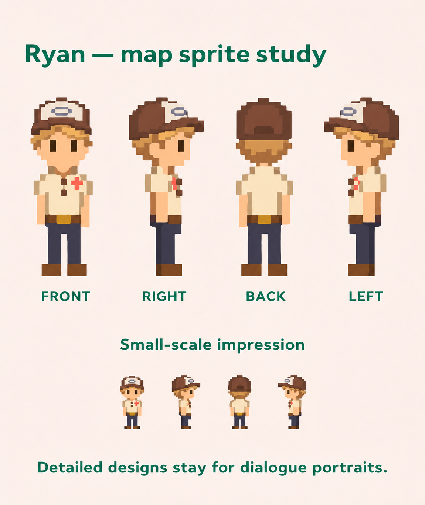

# Ryan — approved map-sprite design 01

Lucas approved this design on November 7, 2026 after the cap was moved onto Ryan's head, the hair was matched to the cap reference, and the trousers' waistband was lowered slightly.

## Appearance to preserve

- Skinny young adult, narrow torso and thin limbs.
- Brown baseball/trucker cap with an off-white front panel, worn forward on his head.
- Short sandy blond hair, softly swept beneath the brim, with short side and back tufts.
- Cream short-sleeve button-down with a coral flower at the chest and sunglasses at the neckline.
- Navy trousers with a slightly lowered waistband, a longer tucked shirt, brown belt, and brown shoes.
- Very simple, chunky pixel shapes in consistent front, right, back, and left views.

The worn cap replaces the earlier cap clipped at the waistband. The flower shirt replaces the earlier gray hoodie.

This approved board is a **map-sprite design reference**, not an animation-ready sheet. Its smaller row illustrates the visual impression at reduced scale; no exact logical pixel resolution has been approved. Prepare aligned runtime sprites and check their scale against the game before integration. Keep a separate, more detailed dialogue portrait based on the retained appearance designs, updated to match the approved cap and hairstyle.

No runtime code, map, or deployment changes accompany this artwork save.

## Provenance and credits

Created and refined with the built-in image editor using the existing Ryan character studies and a personal photo as appearance references. The final edit lowered the waistband and lengthened the shirt slightly. Personal reference photos are not included in this save.

Retain the existing LPC-derived reference-art attribution chain and CC-BY-SA 4.0 modification notices: see [Logan's approved board](../logan-approved-01/README.md) and [the pinned source recipe](../logan-draft-01/recipe.json). This design uses original generated pixel interpretations rather than copied Stardew Valley assets.

## File verification

- PNG size: 1,553,199 bytes.
- Saved byte-for-byte from the approved image, without resizing or recompression.
