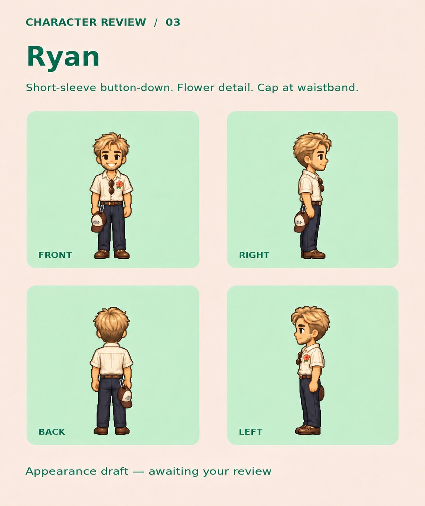
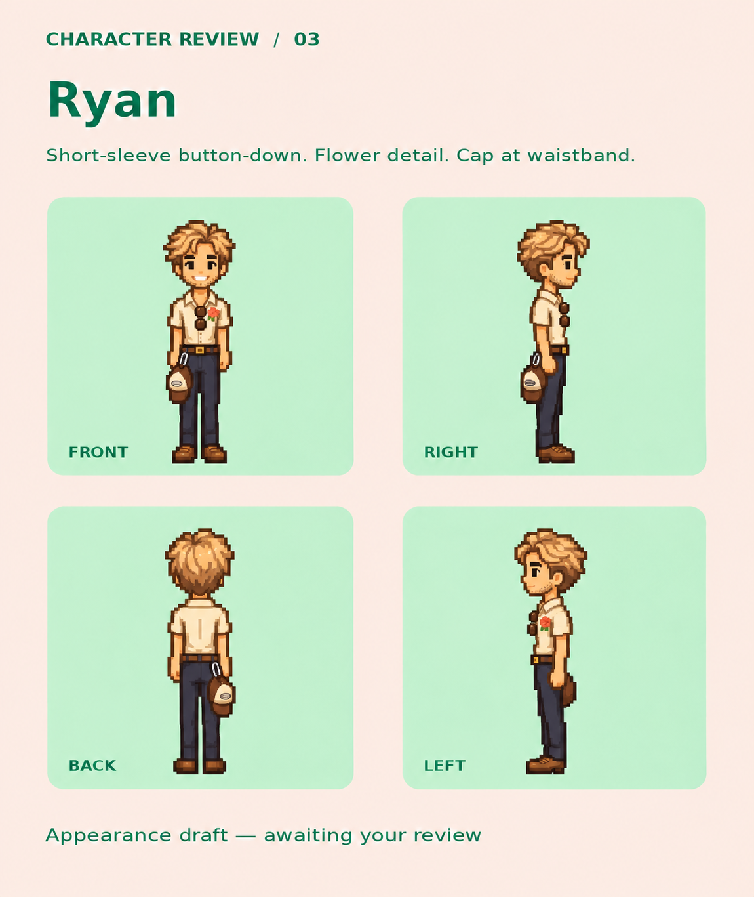

# Ryan — retained appearance review boards

These boards preserve earlier November 7, 2026 explorations. The current approved map-sprite design is [Ryan approved 01](../ryan-approved-01/README.md): cap worn on his head, shorter swept hair, and slightly lowered waistband. The archived boards below are appearance references, not finished animation sheets.

The initial [hoodie preview](ryan-hoodie-superseded.png) is archived for history only; its outfit was superseded by the flower shirt and clipped cap below.

## Historical direction

- Skinny young adult; narrow shoulders/torso, thin arms and legs. Preserve this in the portrait and map sprite.
- Sandy blond hair, light stubble, youthful smile; supplied photos guide likeness.
- Cream short-sleeve button-down, single flower detail, nice navy trousers, brown belt/shoes, sunglasses at neckline.
- Brown/cream baseball cap clipped to the waistband, not worn on the head.
- The gray hoodie in the first preview is superseded.

Lucas then clarified that map characters should be very basic pixel sprites, with a separate, more detailed portrait beside the name during conversations. Keep the detailed design; the later pixel-style board is an exploration, not the final in-world sprite. Ryan's newer simple map-sprite design is approved; its runtime sheet and detailed portrait still need preparation and review.

All three images were created with the built-in image editor using Ryan's personal photos as likeness references and the existing character boards as style references. Personal photos are excluded from the repository. Retain the existing reference-art attribution chain in [Logan's approved board](../logan-approved-01/README.md) and [the original source recipe](../logan-draft-01/recipe.json) when distributing derivative artwork.
