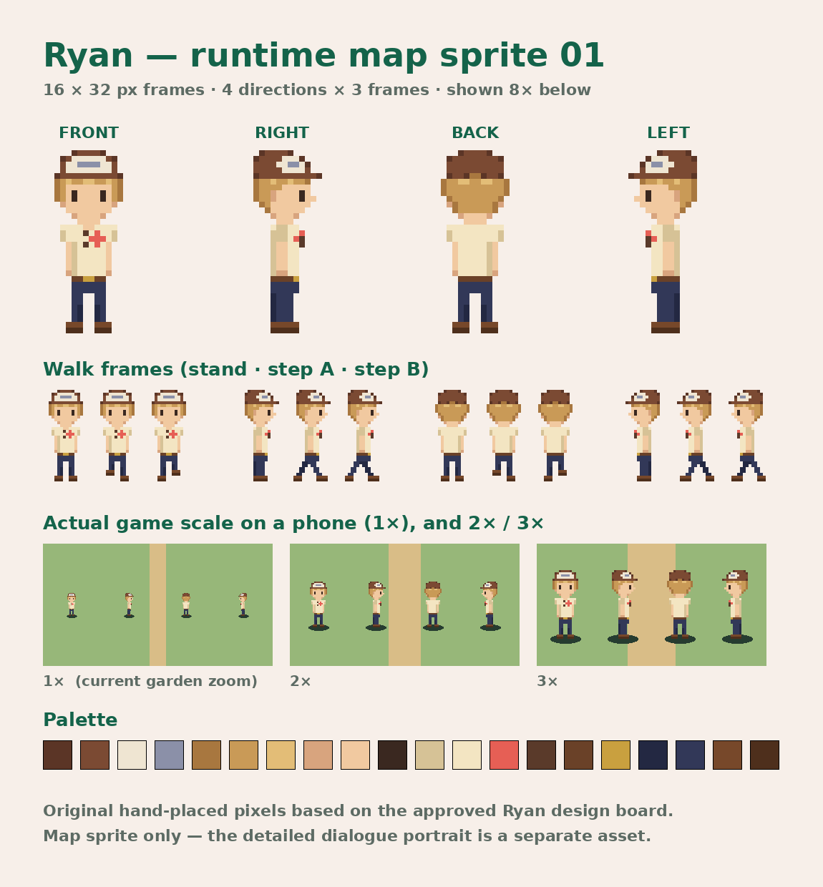
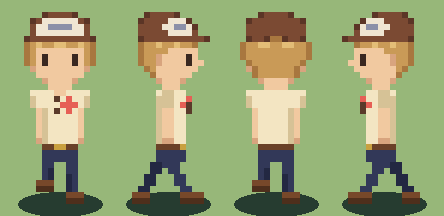
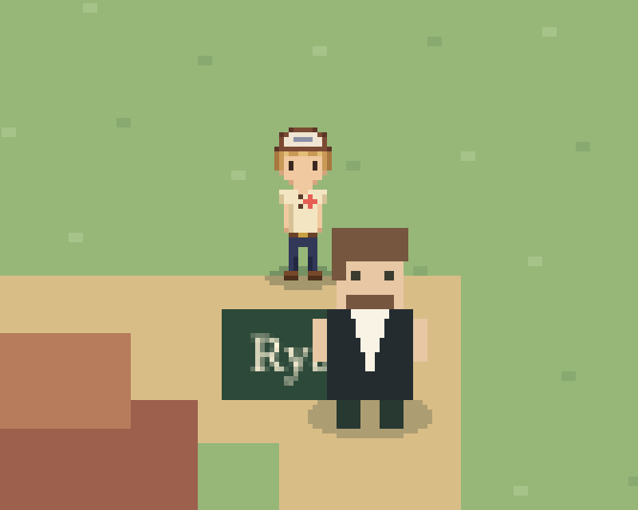

# Ryan — runtime map sprite 01

**Awaiting Lucas's review.** This sheet adapts the [approved Ryan map-sprite design](../ryan-approved-01/README.md) to game scale. It is not yet integrated into the game; the map, movement, dialogue and saved progress are unchanged.





## Runtime sheet

- `ryan-sheet.png` — 48 × 128 px, transparent background.
- Frames are **16 × 32 px** (a proposal, matching the current placeholder figures' size).
- Rows: down (front), right, up (back), left. The left row mirrors the right row.
- Columns: stand, step A, step B. Walk cycle: step A → stand → step B → stand.
- Feet touch the bottom row; anchor at origin (0.5, 1) on the character's ground point. Draw the ground shadow in the engine.
- Shown at 1 sprite pixel = 1 world unit, the current garden zoom. Use nearest-neighbor scaling only.
- `ryan-sheet-x8.png` is an 8× enlargement for viewing.

Phaser loading (for later integration):

```js
this.load.spritesheet('ryan', 'ryan-sheet.png', { frameWidth: 16, frameHeight: 32 });
// frame index = row * 3 + column
```

## Game-scale check

The sheet was temporarily dropped into the playable build (not committed) and screenshotted in Chromium at a 390 × 844 phone viewport (3× device pixels):



Full screen: [ryan-in-game.png](ryan-in-game.png). Ryan stands about 32 CSS px tall, next to Logan's 38 px code-drawn placeholder. His cap, flower shirt, navy trousers and blond hair stay readable at that size. This is a browser check, not a physical-device test.

## Appearance kept from the approved design

Skinny build; brown cap with an off-white front panel and gray-blue logo, worn forward; short sandy blond hair under the brim; cream short-sleeve shirt with a coral flower; sunglasses at the neckline; brown belt with a gold buckle at a slightly lowered waistband; navy trousers; brown shoes.

## Rebuild and provenance

`build_sprite.py` holds every pixel as text grids plus the palette, and regenerates all images here (requires Pillow):

```sh
python3 build_sprite.py
```

The pixels are original and hand-placed, using the approved design board as the visual reference. No LPC layers, Stardew Valley or Pokémon assets and no personal photo pixels are used. The detailed dialogue portrait is a separate asset that is still to be made.
