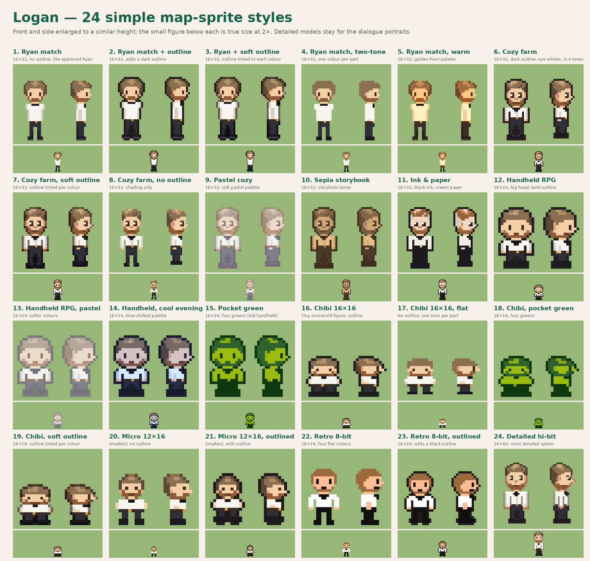

# Simple map-sprite styles 01 — Logan

On November 8, 2026 Lucas returned to the original plan: **very simple sprites on the map, with the detailed models shown beside the speaker's name in conversations.** He asked for at least 20 simple styles, using Logan's approved model as the reference.

Logan wears his preferred look in every style: white shirt, black bow tie, black trousers and shoes, short dirty-blond hair and short beard. Each cell shows front and side enlarged, plus the front at true size (2×) on grass.

| # | Style | Size |
| --- | --- | --- |
| 1–5 | Ryan match: plain, + dark outline, + soft tinted outline, two-tone, warm palette | 16 × 32 |
| 6–11 | Cozy farm: standard, soft outline, no outline, pastel, sepia, ink & paper | 16 × 32 |
| 12–15 | Handheld RPG: standard, pastel, cool evening, pocket green | 16 × 24 |
| 16–19 | Chibi: outlined, flat, pocket green, soft outline | 16 × 16 |
| 20–21 | Micro: plain, outlined | 12 × 16 |
| 22–23 | Retro 8-bit: plain, outlined | 16 × 24 |
| 24 | Detailed hi-bit | 24 × 40 |

Seven hand-drawn base figures are combined with outline, shading and palette treatments. All art is original, in the spirit of each genre, not copied from any game. Front and side only; back views and walking frames follow once a style is chosen, then the rest of the cast in the same style.

Rebuild: `python3 tools/sprites/simple_styles.py`.

The detailed Logan and Angie models are kept for the dialogue portraits: see the approved boards and [board-sprites-01](../board-sprites-01/README.md), which is no longer the map-sprite plan.
