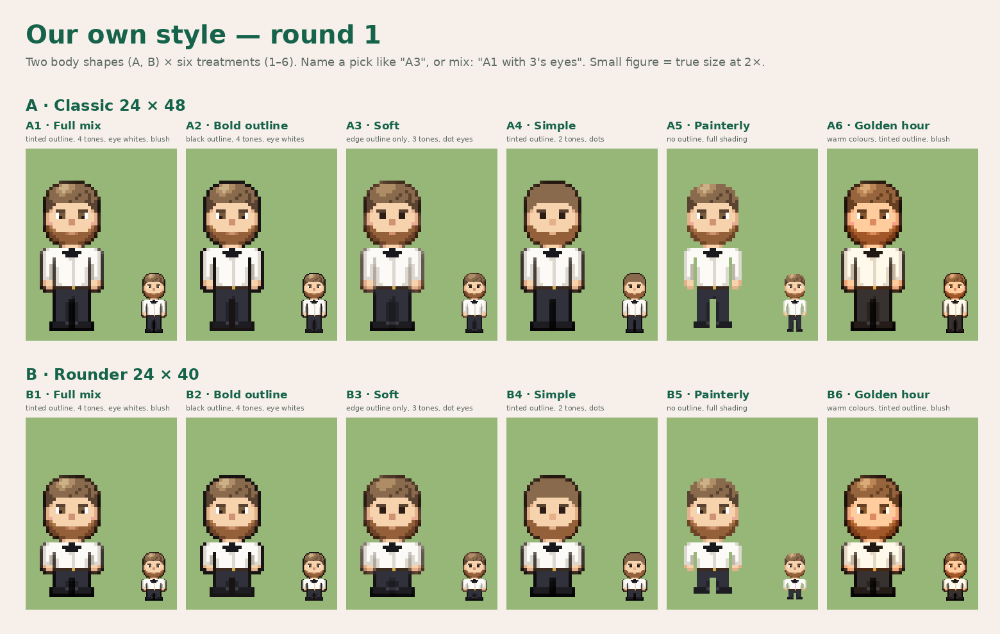
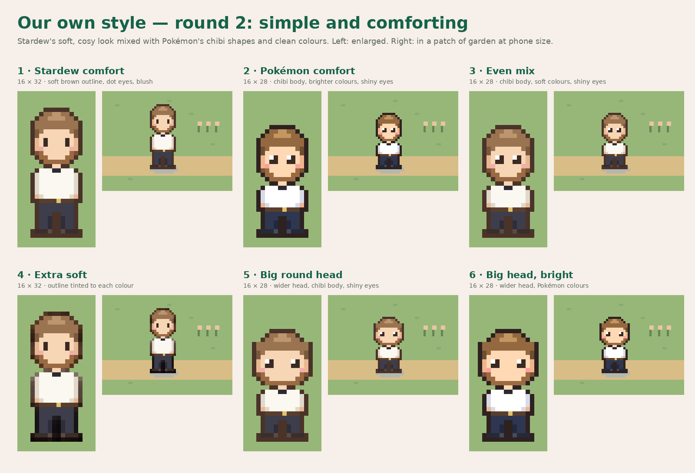

# Our own character style — mixing rounds

Lucas (November 8, 2026): after playtesting, the 16 × 24 sprites looked too pixelated. He asked to "make our own style of characters" by mixing Stardew-like art traits until one feels right. Each round is drawn with Logan (white shirt, bow tie) as the test character; the chosen style is then applied to the whole cast. All pixels are original.

## Round 1

Two body shapes: **A** classic 24 × 48 (head about 40% of the height) and **B** rounder 24 × 40. Six treatments vary one trait family at a time:

1. Full mix: outline tinted to each colour, 4 tones, eye whites, blush
2. Bold: black outline, 4 tones, eye whites
3. Soft: outline only around the silhouette, 3 tones, dot eyes
4. Simple: tinted outline, 2 tones, dot eyes
5. Painterly: no outline, full shading
6. Golden hour: warm colours, tinted outline, blush

Rebuild: `python3 tools/sprites/style_mix.py`.

## Round 2 — simple and comforting

Lucas: round 1 was not what he imagined. He likes Stardew's simple, comforting designs, mixed with Pokémon. Round 2 uses rounded heads, soft brown outlines, gentle 2–3 tone shading, dot or shiny eyes and blush, with chibi proportions and clean colours from Pokémon. Each is shown enlarged and in a patch of garden at phone size.

1. Stardew comfort (16 × 32) · 2. Pokémon comfort (16 × 28, brighter) · 3. Even mix (16 × 28, soft colours, shiny eyes) · 4. Extra soft (tinted outline) · 5. Big round head · 6. Big head, bright

Rebuild: `python3 tools/sprites/style_mix2.py`.
