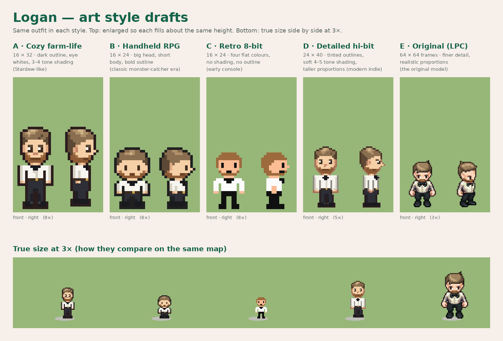

# Art style drafts 01 — pick a direction

Logan is drawn in the same outfit in each style: white shirt, black bow tie, black trousers and belt, trimmed warm-brown beard, short ash-brown hair. Colours follow the reference photos Lucas supplied (not stored here). Front and right views only; walking frames come after a style is chosen.

| Style | Size | Character |
| --- | --- | --- |
| A · Cozy farm-life | 16 × 32 | Dark outline, eye whites, 3–4 tone shading (Stardew-like) |
| B · Handheld RPG | 16 × 24 | Big head, short body, bold outline (classic monster-catcher era) |
| C · Retro 8-bit | 16 × 24 | Four flat colours, no shading, no outline (early console) |
| D · Detailed hi-bit | 24 × 40 | Tinted outlines, soft 4–5 tone shading, taller proportions (modern indie) |
| E · Original (LPC) | 64 × 64 frames | The rebuilt original model, white shirt and bow tie, no cardigan |

A–D are original hand-placed art in the spirit of each genre, not copied from any game. E uses LPC layers; see [logan-lpc-01](../logan-lpc-01/README.md) for credits.

Rebuild: `python3 tools/sprites/styles.py` (E needs `docs/art/logan-lpc-01/logan-walk.png`, built by `tools/sprites/lpc_logan.py`).
